### N.O.V.A. 
revived by IX32PSL from Informaldehyde-xd 

Hello, well here's the N.O.V.A. 1, 2 is also on the way. it's actually a beautiful game imo.
hope you guys enjoy it.

Consider to join out Discord server 'The Great Games Society' 🔗 ---
https://discord.gg/548gvGuky

## Note:- 
1.Virus and malware scan is recommended for your own satisfaction.

2.the game is in the IX32PSL'S apk shell, which lets the game install, then translates the 32 bit codes. 
and also manage the external game files.

3.Allow the storage permission for this game, without permission it will not work 
because you have to put the cache files in internal storage/gameloft/games/ folder like this. and to access those files the permission is needed....
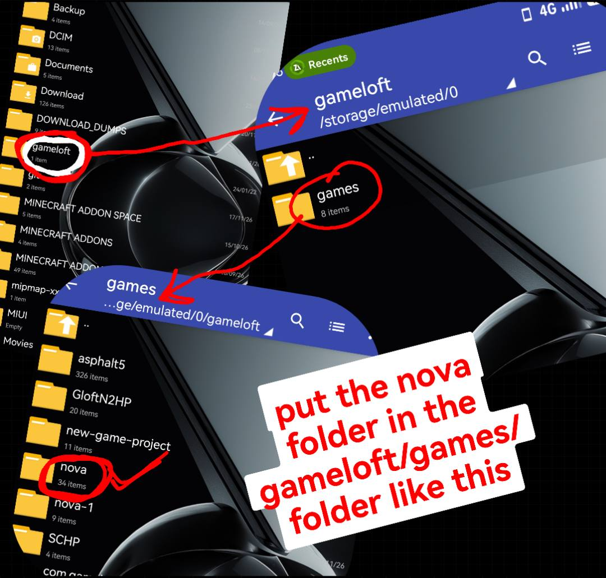

4.Apk and Cache files are different. install the apk and extract the cache zip as said above.

### Setup:-

1. on first launch the game might crash, but you have to allow the permission and it will be all good

2. after the game starts. I haven't hardcoded the screen settings, size and position. the touch might feel misplaced so use the screen adjustment menu. **Tap with 4 fingers at once to activate the menu**.
   
* if the buttons didn't work, then tap the GL up button and adjust[ the touch controls on place. probably picture with 50 pixels up will work on most devices. like this....
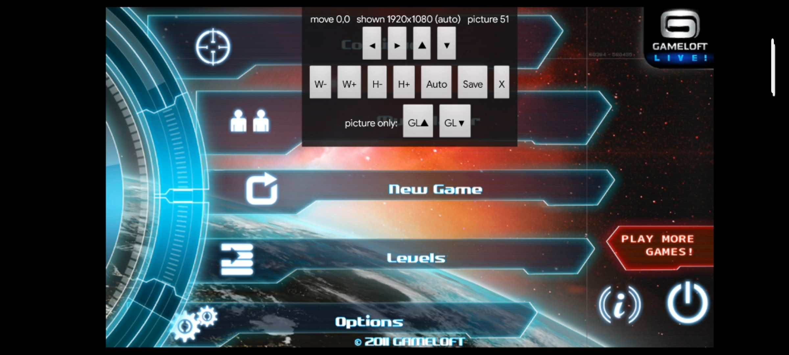

*you can also change the size, stretch it and make it for yourself. just open the menu with 4 fingers tap.

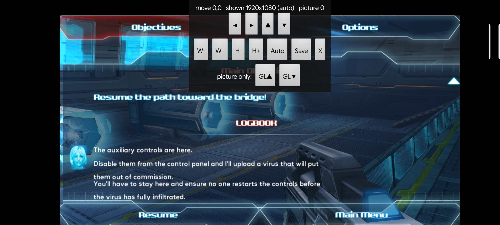
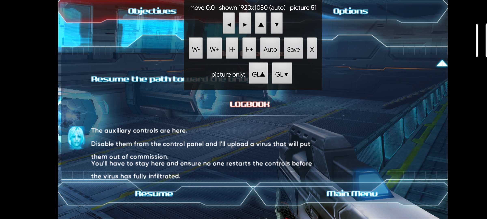
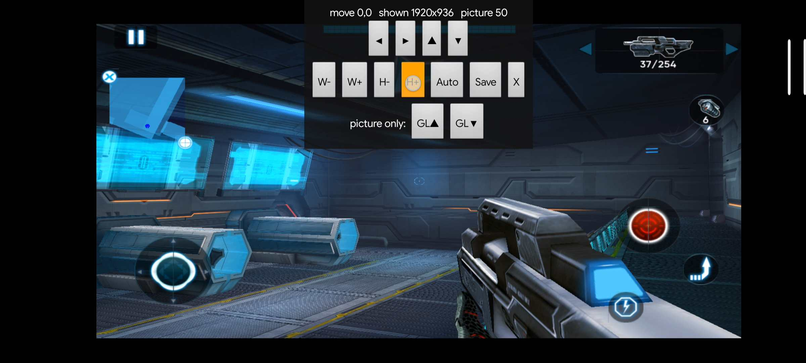
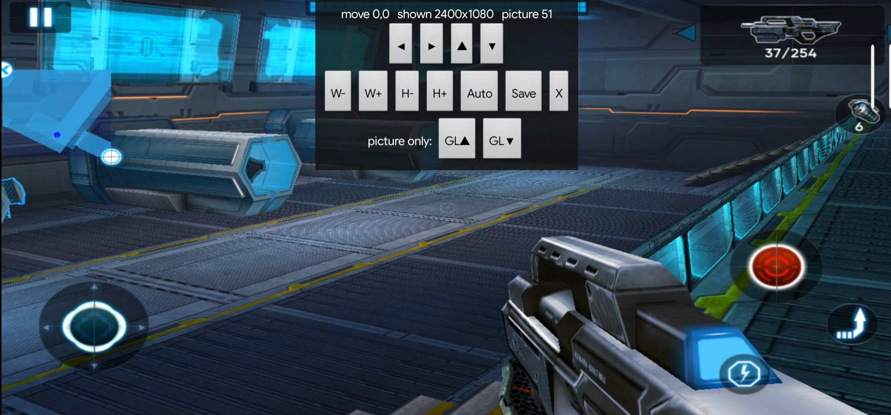

like these ....

## Gameplay Shots
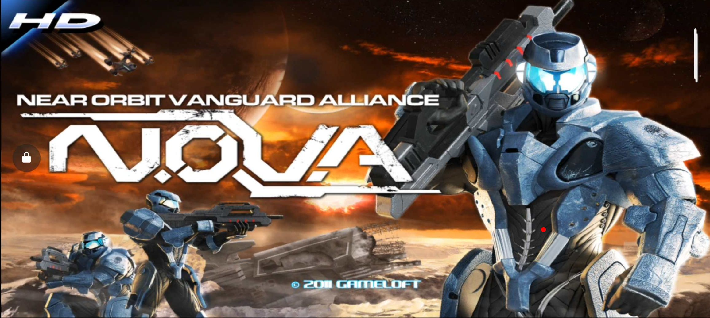
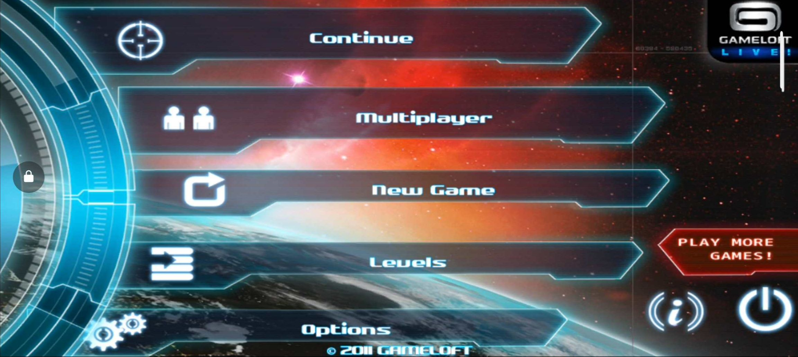
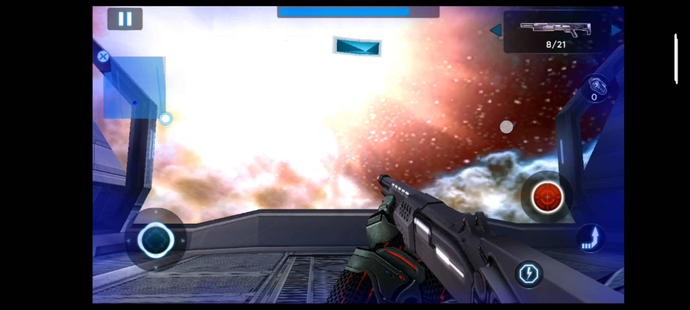
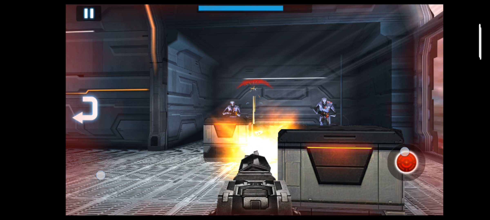
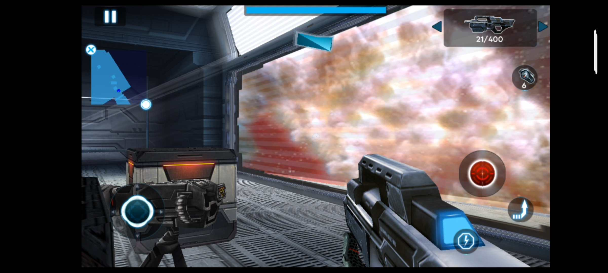
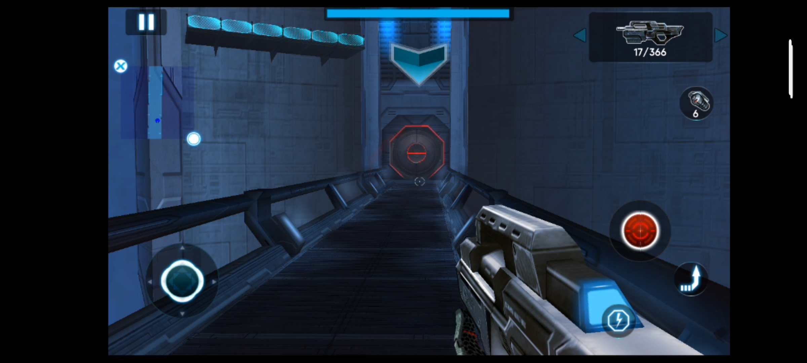
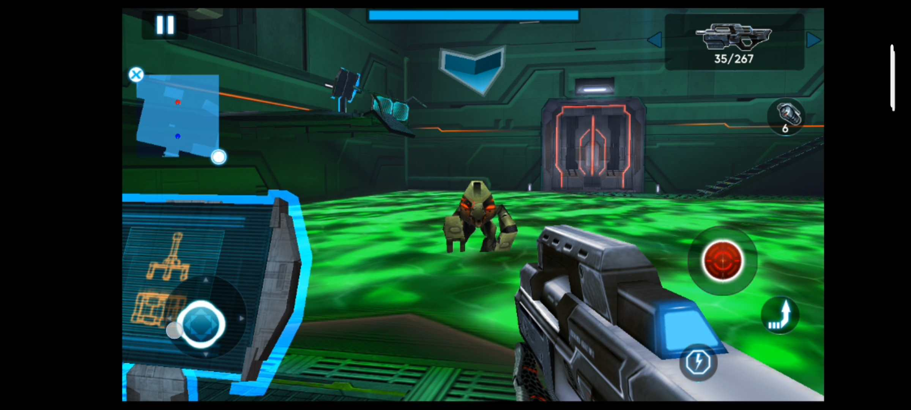
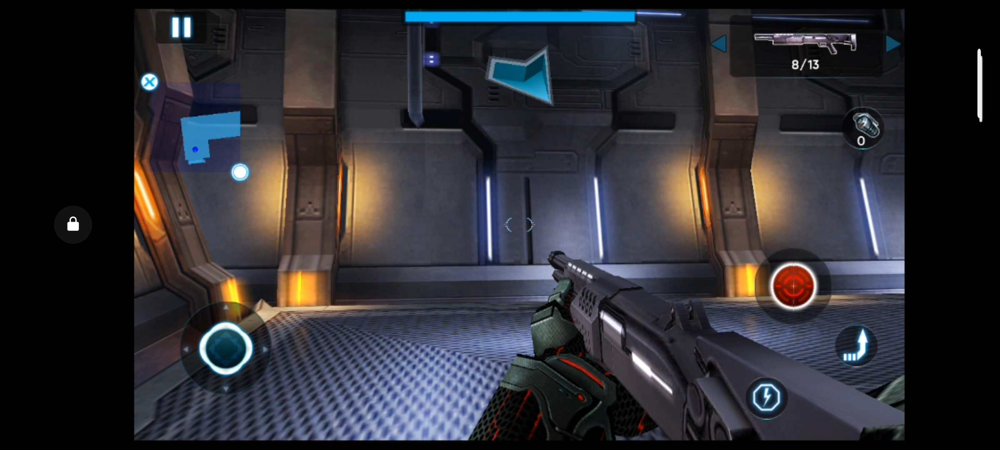
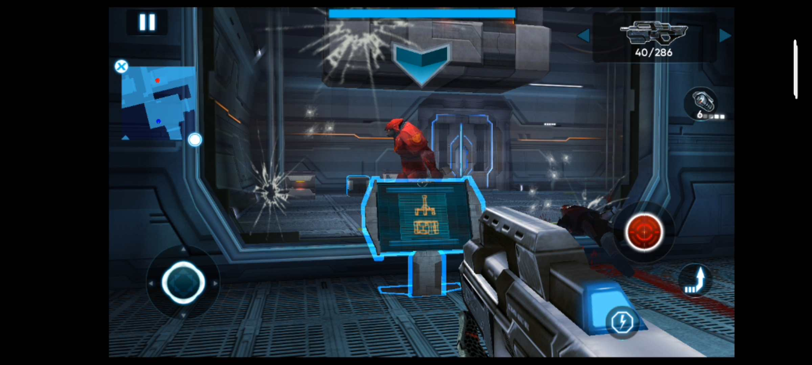

